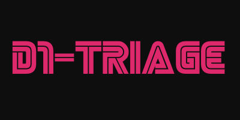

<p align="center">
  
</p>

<p align="center">
  <a href="https://huggingface.co/barryallen16/d1-3B-java-vuln-triage"></a>
  <a href="https://huggingface.co/datasets/barryallen16/d1-triage"></a>
  <a href="https://barryallen16.github.io/d1-triage/"></a>
  <a href="audit/TECHNICAL_REPORT.md"></a>
</p>

# d1-triage: Static Analysis Alert Triage with Liquid AI d1-3B

Static analysis scanners flag security bugs with high recall, but false-positive rates exceed 70%.
d1-triage uses Liquid AI's hybrid d1-3B to rank alerts by exploitability in under 15 ms, letting developers review real vulnerabilities first.

---

## Quickstart

Install with uv (recommended):

```bash
uv tool install git+https://github.com/barryallen16/d1-triage.git
```

Or with pip:

```bash
pip install git+https://github.com/barryallen16/d1-triage.git
```

Run the standalone CLI locally on standard CPU:

```bash
# 1. Interactive demo: path traversal vs guarded XML parser
d1-triage --demo

# 2. Triage a Semgrep report and export prioritized JSON
d1-triage --scan semgrep-findings.json --output triage-report.json

# 3. Sample 5 benchmark alerts
d1-triage --benchmark ghsa --limit 5
```

Add `--mock` to any command for a dry run without downloading model weights.

---

## Benchmark leaderboard

Evaluated on 174 real-world Java alerts from 68 GitHub advisories (GHSA) and all 126 Vul4J benchmark repositories.

| Model / Configuration | Architecture | Verified Patch AUC | Same-Rule AUC | Rule-Swap Delta | Vul4J Real CVEs | Latency / Hardware |
|---|---|---|---|---|---|---|
| **Semgrep Baseline** | Scanner rules | 0.5235 | 0.5000 | N/A | 0.5778 | <1 ms (CPU) |
| **Kev-4B** | 4B Transformer | 0.7167 | 0.5100 | +0.0180 | 0.6667 | ~85 ms / 12.8 GB VRAM |
| **d1-3B Base Model** | 3B Hybrid SSM | **0.8372** | 0.5495 | +0.0202 | **0.8000** | 12 ms / 6.2 GB VRAM |
| **d1-3B Targeted Prompt** | 3B Hybrid SSM | 0.6261 | 0.5761 | +0.0749 | **0.8000** | 12 ms / 6.2 GB VRAM |
| **d1-3B Contrastive LoRA** | 3B Hybrid SSM | 0.5988 | **0.6594** | **+0.0839** | 0.5444 | 14 ms / 6.3 GB VRAM |
| **d1-3B 50/50 Ensemble** | 3B Hybrid SSM | 0.6125 | **0.6280** | +0.0794 | **0.8000** | 25 ms / 6.3 GB VRAM |

*Definitions*: Verified patch marks finding lines inside verified security fix hunks that match the advisory CVE type.
Same-rule AUC measures discrimination among alerts from the same rule family.
Swap delta measures the drop in AUC when swapping code behind identical rules.
The four verification filters are detailed in [audit/TECHNICAL_REPORT.md](audit/TECHNICAL_REPORT.md).

---

## Core findings

Scanners report 1-based file lines, but models receive unnumbered method snippets.
Injecting `>>> [ALERT LINE X]` anchors the attention on the flagged statement, lifting within-rule AUC from 0.4297 to 0.5986.

Training on synthetic Juliet test cases degraded real-world transfer.
Fine-tuning on 416 real pre- and post-fix commit diffs achieved 0.6594 within-rule AUC on verified fix hunks.

On verified fix hunks, d1-3B scores 0.8372 AUC compared to Kev-4B's 0.7167.
It runs in 12 to 14 ms on an Nvidia T4 using 6.2 GiB VRAM versus Kev-4B's 12.8 GiB.

---

## One-command reproduction

Calculate all metrics on CPU in under 0.2 seconds:

```bash
python audit/evaluate_d1.py
```

Run the 19-test verification suite:

```bash
python audit/test_whole_suite.py
```

---

## Published artifacts

| Resource | Platform | Link | Description |
|---|---|---|---|
| **Model Weights** | Hugging Face | [`barryallen16/d1-3B-java-vuln-triage`](https://huggingface.co/barryallen16/d1-3B-java-vuln-triage) | Fine-tuned Liquid AI d1-3B Q8_0 weights (2.87 GB) |
| **Benchmark Dataset** | Hugging Face | [`barryallen16/d1-triage`](https://huggingface.co/datasets/barryallen16/d1-triage) | 174 real-world Java alerts across GHSA & Vul4J census |
| **Interactive Demo** | GitHub Pages | [`barryallen16.github.io/d1-triage`](https://barryallen16.github.io/d1-triage/) | In-browser triage pipeline playground with AST grounding |
| **Technical Report** | Audit & Proofs | [`audit/TECHNICAL_REPORT.md`](audit/TECHNICAL_REPORT.md) | Empirical proofs, rule priors, and confidence bounds |
